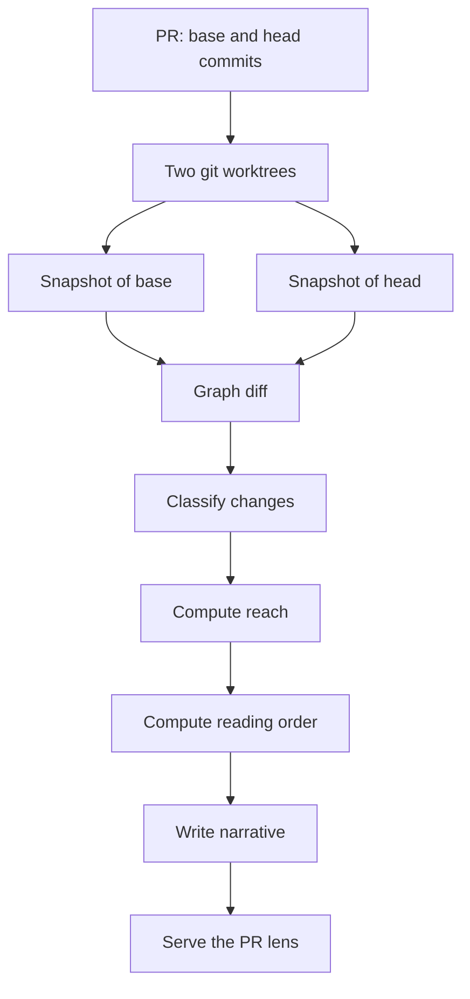

# phia design

Status: draft 1, 2026-11-10. Nothing in this file is built or measured.
Every number is a target or a guess, and is marked as such.

Contents:

- [Idea](#idea)
- [Vocabulary](#vocabulary)
- [Model](#model)
- [Phase 0: phia on phia](#phase-0-phia-on-phia)
- [Phase 1: graph engine](#phase-1-graph-engine)
- [Phase 2: PR lens](#phase-2-pr-lens)
- [Phase 3: codebase lens](#phase-3-codebase-lens)
- [Technology choices](#technology-choices)
- [Spikes](#spikes)
- [Risks](#risks)
- [Open questions](#open-questions)
- [Earlier tools](#earlier-tools)

## Idea

Literate programming asks the author to write a narrative and to hang
the code from it. Few authors paid that cost. An LLM can write the
narrative from the code, so the cost moves from the author to a machine.

Go offers many separate ways to look at code:

- Files and directories.
- Packages, with exported and unexported types, as godoc shows them.
- Code navigation: which types implement an interface, who calls a
  function.
- Call stacks and flame graphs.
- gRPC and proto definitions.
- Design diagrams.
- Folded and unfolded code.

Each of these is a projection of the same facts. phia stores the facts
once, in a symbol graph, and draws each projection from the graph.

```mermaid
flowchart LR
    repo[Go repository at a commit] --> engine[Graph engine]
    engine --> graph[(Symbol graph)]
    graph --> prlens[PR lens]
    graph --> cblens[Codebase lens]
    prlens --> ui[Web UI]
    cblens --> ui
    ui --> notes[Notes: ask, change, export]
```

A codebase and a PR use the same graph.

- A codebase is the graph at one commit.
- A PR is the difference between the graph at the base commit and the
  graph at the head commit, plus the neighbors of the changed symbols.

The PR lens is built first for one reason. The diff selects the symbols
to show. The codebase lens must rank every symbol in the repository, and
the ranking signal is not known. See [Open questions](#open-questions).

## Vocabulary

Each term has one meaning in this file.

| Term | Meaning |
|---|---|
| Symbol | A named declaration: package, type, function, method, field, constant, variable, proto service, proto RPC, proto message. |
| Symbol ID | A string that names one symbol and does not contain a file position. See [Symbol ID](#symbol-id). |
| Edge | A relation between two symbols, for example "calls" or "implements". |
| Snapshot | The graph of one repository at one commit. |
| Graph diff | The symbols and edges that differ between two snapshots. |
| Reach | The symbols that a change can affect. Earlier notes call this the blast radius. |
| Lens | A set of views over the graph for one task. There are two: the PR lens and the codebase lens. |
| Derived fact | A statement that static analysis produced, for example "`Foo` has 14 callers". |
| Narrated claim | A statement that an LLM wrote. Each narrated claim carries anchors. |
| Anchor | A reference from a claim or a note to a symbol ID, with a content hash. |
| Note | Text that the reader attaches to a symbol or to lines in a symbol. |

## Model

The model is a directed graph. A node is a symbol. An edge is a relation
between two symbols.

### Nodes

| Kind | Example | Parent |
|---|---|---|
| Module | `github.com/gravitational/teleport` | none |
| Package | `lib/srv/app` | Module |
| File | `session.go` | Package |
| Type | `app.Server` | Package |
| Function | `app.New` | Package |
| Method | `app.Server.Start` | Type |
| Field | `app.Server.cfg` | Type |
| Constant, Variable | `app.defaultTTL` | Package |
| Proto service | `teleport.app.v1.AppService` | Proto file |
| Proto RPC | `AppService.GetApp` | Proto service |
| Proto message | `teleport.app.v1.App` | Proto file |

Local variables, parameters and closures are not nodes. A closure
belongs to the function that declares it.

Every node has these attributes:

- `id`: the symbol ID.
- `kind`: one row of the table above.
- `exported`: true or false.
- `doc`: the godoc text.
- `signature`: the declaration without the body.
- `pos`: file, start line, end line. `pos` is for display only.
- `lines`: the count of lines in the declaration.
- `hashSig`, `hashBody`, `hashDoc`: three content hashes. See
  [Content hashes](#content-hashes).
- `tags`: zero or more of `generated`, `test`, `deprecated`, `main`.

### Edges

| Edge | From | To | Source |
|---|---|---|---|
| `contains` | parent | child | syntax tree |
| `calls` | function or method | function or method | type-checked call expressions |
| `implements` | type | interface type | `types.Implements` |
| `references` | any | any | `types.Info.Uses` that is not a call |
| `embeds` | type | type | struct and interface embedding |
| `imports` | package | package | import declarations |
| `tests` | test function | function or method | `calls` edges that start in a `_test.go` file |
| `rpc-impl` | Go method | proto RPC | the generated server interface |
| `rpc-call` | Go function | proto RPC | calls on the generated client |

Every edge has a `certainty` attribute.

- `exact`: the compiler resolves the target. A direct function call is
  exact.
- `possible`: the target depends on a runtime value. A call through an
  interface has one `possible` edge to each method that implements it.

The UI draws `possible` edges with a dashed line. The reader can hide
them.

### Symbol ID

A symbol ID is the import path and the name of the symbol inside the
package.

```
github.com/gravitational/teleport/lib/srv/app            package
github.com/gravitational/teleport/lib/srv/app.Server     type
github.com/gravitational/teleport/lib/srv/app.Server.Start   method
github.com/gravitational/teleport/lib/srv/app.Server.cfg     field
github.com/gravitational/teleport/lib/srv/app.New        function
proto:teleport.app.v1.AppService.GetApp                  proto RPC
```

A symbol ID does not contain a file name or a line number. A symbol
keeps its ID when the declaration moves to another file in the same
package. Notes and narrative anchors use symbol IDs, so they remain
valid after a rebase.

Two cases need an extra rule:

- `init` functions and `_` declarations do not have unique names. Their
  ID gets the file name and an index: `app.init#session.go#0`.
- Test packages (`app_test`) are separate packages with their own IDs.

### Content hashes

Each declaration has three hashes. The engine prints the declaration
with `go/printer` and hashes parts of the output.

| Hash | Covers | A change means |
|---|---|---|
| `hashSig` | name, receiver, parameters, results, type definition | the API changed |
| `hashBody` | the function body, without comments | the behavior may have changed |
| `hashDoc` | the godoc comment | the documentation changed |

Printing with `go/printer` removes formatting differences. A commit that
only runs `gofmt` does not change a hash.

## Phase 0: phia on phia

phia is used on phia from the first day. Each phase has phia itself as
its first user.

| Phase | phia uses it on |
|---|---|
| 0 | this design document |
| 1 | the Go code of the graph engine |
| 2 | every PR to the phia repository |
| 3 | the phia repository as a whole |

No Go code exists in the design phase. The only artifact is this file.
Phase 0 therefore treats the design document as the codebase.

### The design as a graph

The site at [phia.foo](https://phia.foo) reads `design.md` in the
browser and builds a small graph from it. Nothing on the page is
written twice. A change to `design.md` changes the page.

| Model term | In Phase 0 |
|---|---|
| Symbol | a section of this file. A `##` heading is a top-level symbol. A `###` heading is its child. |
| Symbol ID | the heading anchor, for example `phase-2-pr-lens/reach` |
| `contains` edge | a section and its subsections |
| `references` edge | a link from one section to another |
| Size | the word count of the section |
| Content hash | a hash of the section text |
| Derived fact | a count that the page computes: sections, words, links, open markers |
| Open marker | a phrase that admits a gap, for example "not measured", "not tested", "to verify", "guess" |

### The three panes

The page has the [layout](#layout) of the PR lens.

- **Outline.** The sections in reading order, with the first sentence
  of each.
- **Map.** One box per section. The area of a box is its word count. A
  box with open markers shows their count. The selected section
  highlights the sections that it links to and the sections that link
  to it.
- **Text.** The selected section, with three fold levels: heading,
  first paragraph, full text.

A selection in one pane selects the same section in the other two.

### Read marks for sections

The reader marks a section as read. The browser stores the mark with
the content hash of the section, in local storage.

- When the text of a section changes, its hash changes, and the mark
  is removed.
- The header shows the share of words that are marked as read.

A second visit then shows which sections changed since the first
visit. This is the Phase 2 [read mark](#read-marks), tested on prose before any Go
code exists.

### Not in Phase 0

- Narrated claims. The page shows derived facts only.
- Notes. Comments on the design go to GitHub issues.
- A server. The page is static files.

### Site and domain

- GitHub Pages serves the `docs/` directory of the `main` branch.
- The custom domain is `phia.foo`. The file `docs/CNAME` contains the
  domain.
- DNS for `phia.foo` is at Cloudflare. The records are listed in the
  README.
- The `.foo` top-level domain is on the HSTS preload list. Browsers
  refuse plain HTTP for it. The site is reachable only after GitHub
  has issued the certificate.
- The page loads three libraries from `docs/vendor/`: marked (Markdown
  parser), d3-hierarchy (map layout) and mermaid (diagrams). The page
  does not load scripts from other hosts.

### Done when

1. `https://phia.foo` shows this file in three panes.
2. An edit to one section of `design.md` removes the read mark of that
   section and of no other section.
3. Julia can find the section she looks for from the map alone.

## Phase 1: graph engine

The engine is a Go library and a CLI. It has no UI.

### Input and output

- Input: a repository path, a commit, and a scope. The scope is a list
  of package patterns, for example `./lib/srv/app/...`.
- Output: one snapshot.

### Passes

The engine loads packages with `golang.org/x/tools/go/packages`,
with syntax, types and type information. It then runs these passes.

| Pass | Reads | Produces |
|---|---|---|
| Declarations | syntax trees, `types.Info.Defs` | nodes, `contains` edges, `pos`, `lines`, `signature` |
| Doc | comment groups | `doc` |
| Hash | `go/printer` output | `hashSig`, `hashBody`, `hashDoc` |
| Tags | file header, file name | `generated` when the header matches `^// Code generated .* DO NOT EDIT\.$`, `test` for `_test.go` |
| References | `types.Info.Uses` | `references` and `embeds` edges |
| Calls | call expressions, `types.Info` | `calls` edges, `exact` for static calls, `possible` for interface calls |
| Implements | named types and interfaces in scope | `implements` edges |
| Tests | `calls` edges | `tests` edges |
| Proto | `.proto` files, generated Go files | proto nodes, `rpc-impl` and `rpc-call` edges |

Two optional passes add attributes that the lenses use for size and
rank.

| Pass | Reads | Produces |
|---|---|---|
| Churn | `git log --numstat` | commits and changed lines per file over a period |
| Profile | a pprof file | flat and cumulative weight per function |

### Calls pass

The first version resolves calls from the syntax tree and type
information. It does not build SSA (static single assignment form, the
compiler-style representation that precise call graph algorithms need).

- A call to a function or to a method on a concrete type gives one
  `exact` edge.
- A call to an interface method gives one `possible` edge to each
  method in scope that implements the interface method. This is class
  hierarchy analysis.
- A call to a function value gives no edge. The engine records the call
  site as unresolved and counts it.

`golang.org/x/tools/go/callgraph` has more precise algorithms (RTA,
VTA). They need SSA for the whole program. [Spike S2](#spikes) measures the cost
on Teleport before the engine adopts one.

### Proto pass

- The engine parses `.proto` files and creates service, RPC and message
  nodes.
- For each service `X`, the generated Go code declares an interface
  `XServer` and a client type. The engine finds both by name in the
  package that the `go_package` option names.
- Each method of a type that implements `XServer` gets an `rpc-impl`
  edge to the RPC.
- Each call to a method of the generated client gets an `rpc-call` edge
  to the RPC.

The result joins the caller of an RPC to its handler across the network
boundary.

### Scope and scale

Loading every package of a large monorepo with type information is
slow and uses much memory. The cost on Teleport is not measured.
[Spike S1](#spikes) measures it.

The engine therefore loads a scope, not the whole repository.

- For the PR lens, the scope is the changed packages plus the packages
  that import them, to a depth that the caller sets. The default depth
  is 1.
- For the codebase lens, the scope is what the reader selects.

Edges that leave the scope point to stub nodes. A stub node has an ID
and a kind, and no body.

### Graph diff

`Diff(base, head)` compares two snapshots by symbol ID.

| Result | Condition |
|---|---|
| Added | the ID exists only in head |
| Removed | the ID exists only in base |
| Signature changed | `hashSig` differs |
| Body changed | `hashBody` differs and `hashSig` is equal |
| Doc changed | only `hashDoc` differs |
| Moved | all hashes are equal and `pos.file` differs |
| Renamed | one Removed and one Added symbol have equal `hashBody` |

The diff also lists added and removed edges. An added `calls` edge from
an unchanged function cannot happen, so every edge change belongs to a
changed symbol.

### Storage

A snapshot is immutable. The cache key is the repository, the commit,
the scope, and the engine version.

- The engine writes each snapshot to a file in the user cache directory.
- `phia serve` holds the snapshots it needs in memory.

A database is not needed for Phase 1 or Phase 2. See
[Open questions](#open-questions).

### CLI

```
phia graph  [--scope PATTERN] [COMMIT]     build a snapshot, print counts
phia diff   BASE HEAD                      print the graph diff
phia query  SYMBOL --callers|--implements  print neighbors of one symbol
phia serve  [--pr N | BASE HEAD]           start the web UI
```

### HTTP API

`phia serve` exposes the graph as JSON. The web UI is the only client.

```
GET /api/snapshot/{commit}/symbol/{id}             one node and its edges
GET /api/snapshot/{commit}/symbol/{id}/source      the declaration text
GET /api/snapshot/{commit}/neighbors/{id}?edge=calls&dir=in&depth=2
GET /api/diff/{base}/{head}                        the graph diff
GET /api/diff/{base}/{head}/reach                  the reach, grouped by package
```

### Done when

1. `phia graph` builds a snapshot of `lib/srv/app/...` in Teleport, and
   the node count matches a count made by hand for one package.
2. `phia query --implements` returns the same types as gopls does for
   three interfaces chosen by Julia.
3. `phia diff` on one merged Teleport PR lists every changed
   declaration, and marks a `gofmt`-only file as unchanged.
4. A second run on the same commit reads the cache and takes less than
   2 seconds. The number is a target.

## Phase 2: PR lens

### Flow



The reviewer starts the lens with a PR number or with two commits.

```
phia serve --pr 1234
phia serve origin/master HEAD
```

With `--pr`, phia reads the base and head commits and the PR
description through the `gh` CLI. phia does not write to GitHub in this
step.

### Change classes

Each changed symbol gets one class. The class decides the color in the
map and the chapter in the narrative.

| Class | Condition | Shown as |
|---|---|---|
| API | an exported symbol is Added, Removed, or Signature changed | first chapter, strongest color |
| Behavior | Body changed, not a test, not generated | main chapters |
| Internal API | an unexported symbol with Signature changed | with its callers |
| New | Added, unexported | with its first caller |
| Moved or renamed | Moved or Renamed | one line, collapsed |
| Doc | Doc changed only | one line, collapsed |
| Test | tagged `test` | chapter "Tests", next to the symbol it tests |
| Generated | tagged `generated` | one box per generator, collapsed |

### Reach

The reach answers "what can this change affect". The rule depends on
the kind of change.

| Change | Reach |
|---|---|
| Body changed in function `F` | callers of `F`, to depth 2 by default |
| Signature changed in `F` | every caller of `F` in base. Callers that did not change in head are flagged, since they must have changed to compile. |
| Method added to an interface | every type that implemented the interface in base |
| Field added to a struct | every composite literal and every reference to the type |
| Exported symbol removed | every `references` edge to it in base |
| Proto RPC or message changed | `rpc-impl` handlers and `rpc-call` callers |
| Any changed symbol | `tests` edges: the tests that call it, and whether the PR changed them |

The lens groups the reach by package and shows a count for each package.
The reader opens a package to see the symbols.

Three numbers summarize a PR at the top of the page:

- Changed symbols, without generated and moved symbols.
- Packages in the reach.
- Changed non-test symbols that do not have a `tests` edge.

All three are derived facts.

### Reading order

The order is top down: a caller comes before the function it calls.

1. Take the changed symbols and the `calls` edges between them.
2. Find the entry points: changed symbols that no other changed symbol
   calls.
3. Walk from each entry point depth first. The walk gives one thread
   per entry point.
4. Put the API class first, then threads sorted by changed lines, then
   Tests, then Moved, Doc and Generated.

This order needs no LLM. It is the fallback when no narrative exists,
and it is the outline that the narrator must follow.

### Narrative

The narrator is an LLM behind one Go interface. It receives:

- The PR title and description.
- The graph diff with classes, and the reading order.
- For each changed symbol: signature, doc, and the body diff.
- For each thread: the reach summary.

It returns structured data, not free text.

```json
{
  "summary": [
    {"text": "The app server now refreshes the session cache on a timer.",
     "anchors": ["lib/srv/app.Server.refreshLoop"]}
  ],
  "chapters": [
    {"title": "Refresh loop",
     "claims": [
       {"text": "`refreshLoop` starts in `Start` and stops on context cancel.",
        "anchors": ["lib/srv/app.Server.Start", "lib/srv/app.Server.refreshLoop"]}
     ]}
  ]
}
```

Rules that the server enforces, not the prompt:

- Every claim has at least one anchor.
- Every anchor resolves to a symbol in the head or base snapshot. The
  server removes a claim whose anchor does not resolve, and counts it.
- The chapters cover every thread of the reading order. The server
  appends a plain chapter for a thread that the narrator omitted.

The UI shows derived facts and narrated claims in two different styles.
A narrated claim always shows its anchors. A click on an anchor opens
the code.

The narrative is cached by the head commit and the prompt version.

### Layout

The lens has three panes side by side: narrative, map and code.

```
+----------------------+-----------------------------+----------------------+
| Narrative            | Map                         | Code                 |
|                      |                             |                      |
| Summary              |  +--------+ +----+ +-----+  | func (s *Server)     |
| 1. API               |  | app    | |auth| |proto|  |   Start(ctx) error { |
| 2. Refresh loop  <-- |  | [][][] | | [] | | []  |  | +  go s.refreshLoop( |
| 3. Tests             |  +--------+ +----+ +-----+  |   ...                |
| Moved (4)            |                             |                      |
| Generated (2)        |  reach: 6 packages          | callers (3)  tests(1)|
+----------------------+-----------------------------+----------------------+
```

- **Narrative pane.** Chapters in reading order. Each chapter shows how
  many of its symbols are marked as read.
- **Map pane.** One box per package, one inner box per changed symbol.
  The area of a box is its changed lines. The color is the change
  class. Packages in the reach are drawn around the changed packages,
  without color. Edges appear for the selected symbol only, so the map
  does not turn into a tangle of lines.
- **Code pane.** One symbol at a time, with the diff inside the
  declaration. The pane has three fold levels: signature, signature
  with doc, full body. Tabs under the code list callers, implementers
  and tests.

A selection in one pane selects the same symbol in the other two.

### Notes

The reader selects a symbol, or lines inside a symbol, and writes a
note. A note has a kind.

| Kind | What phia does |
|---|---|
| Comment | Stores the note. |
| Question | Sends the note, the symbol and its neighbors to the LLM. Shows the answer under the note, as a narrated claim with anchors. |
| Change | Stores the note as a requested change. `phia notes --prompt` prints all change notes as one prompt for a coding agent. |

An anchor of a note contains:

- The symbol ID.
- `hashBody` at the time of writing.
- The line offset inside the declaration, and the selected text.

When the PR gets new commits, phia looks up the symbol ID in the new
head snapshot.

- If `hashBody` is equal, the note stays as written.
- If `hashBody` differs, the note is marked "code changed since this
  note". phia finds the selected text again if it exists.
- If the symbol ID does not exist, the note moves to a list of detached
  notes.

Notes are stored as one JSON Lines file per PR in the phia data
directory. They are not written into the reviewed repository.

**Export.** `phia notes --pending-review` creates a pending review on
GitHub with one comment per note. A pending review is visible only to
its author. phia never submits a review. The reviewer reads the pending
review on GitHub and submits it by hand.

### Read marks

The reader marks a symbol as read. The mark is stored with `hashBody`.

- A new commit that changes the body removes the mark.
- The header shows the share of changed lines that are marked as read.

A second review of the same PR then shows only what changed since the
first review.

### Done when

1. Julia reviews one real PR of 300 to 1000 changed lines in phia and
   does not open the GitHub diff.
2. For that PR, every narrated claim has an anchor that opens the right
   code. Julia checks ten claims by hand and records how many are wrong.
3. Generated files take one line in the narrative and one box in the
   map.
4. After a force push, notes on unchanged symbols are still attached.
5. The pending review on GitHub contains every exported note at the
   right line.

## Phase 3: codebase lens

Phase 3 is a sketch. Phase 2 will change it.

### The ranking problem

A PR has tens of changed symbols. A repository has tens of thousands.
The codebase lens must choose what to show first.

Candidate signals, none of them tested:

| Signal | Source | Says |
|---|---|---|
| Fan-in | `calls` and `references` edges | many symbols depend on this one |
| Implementers | `implements` edges | this interface is a main abstraction |
| Exported and documented | node attributes | the author meant it to be read |
| Entry points | `main`, RPC handlers, HTTP handlers | execution starts here |
| Profile weight | pprof pass | time is spent here |
| Churn | git pass | people change this often |
| Reader behavior | read marks and notes from Phase 2 | Julia needed to look at this |

Phase 2 produces data for the last row, through its
[read marks](#read-marks). Every PR review records which
symbols in the reach the reader opened. That record is the first real
measure of "important for understanding".

### Views

- **Package map.** The whole scope as nested boxes. The reader chooses
  what the area means: lines, fan-in, churn, or profile weight.
- **Bones.** The top N symbols by the chosen rank, with the edges
  between them. N starts at 20.
- **Interfaces.** Each interface with its implementers and its callers.
- **RPC map.** Proto services, their handlers and their callers.
- **Tour.** A narrative for one package or one feature, built like the
  PR narrative: a reading order from entry points, then narrated claims
  with anchors.

### Design documents

A design document can use the same anchors as a [note](#notes).

- A section of a design document links to symbol IDs.
- phia shows the section next to the code, and the code next to the
  section.
- When `hashSig` of an anchored symbol changes, phia flags the section
  as possibly out of date.

This is the link between design and code that literate programming
aimed for, without one file containing both.

### A codebase as a PR

A whole repository can be loaded as a diff against an empty base. The
PR lens then works without new code. Every symbol counts as changed, so
the [reading order](#reading-order) and the map need a rank to cut
them down. The
plumbing is shared. The ranking is new work.

### Done when

1. A reader who does not know a Teleport package can name its five main
   types and its entry points after ten minutes in phia.
2. The same test with pkg.go.dev and an editor takes longer. Both
   results are recorded.

## Technology choices

Each row is a proposal with its status.

| Part | Proposal | Reason | Status |
|---|---|---|---|
| Engine | Go, `go/packages`, `go/types`, `go/printer` | the standard tools for the job | proposed |
| Call graph | syntax and types first, `x/tools/go/callgraph` later | no whole-program SSA at the start | depends on S2 |
| Proto parser | `github.com/bufbuild/protocompile` | parses `.proto` without `protoc` | to verify |
| Profile parser | `github.com/google/pprof/profile` | reads pprof files | to verify |
| Server | Go `net/http`, UI files embedded with `embed` | one binary | proposed |
| UI | TypeScript with Svelte | Julia has used Svelte | open |
| Code view | CodeMirror 6 | folding and diff decorations | to verify |
| Map | D3 treemap | nested boxes with area | to verify |
| Graph layout | ELK | layered layout for call threads | to verify |
| Narrator | one Go interface, one LLM provider behind it | provider and model can change | open |
| Notes store | JSON Lines files | readable, diffable | proposed |

"To verify" means the library is believed to fit and no spike has used
it.

## Spikes

Each spike answers one question before the phase that depends on it.

| Spike | Question | Pass |
|---|---|---|
| S1 | How long does `go/packages` take to load `lib/srv/app/...` and its importers in Teleport with full type information, and how much memory? | under 60 seconds and under 8 GB. Both numbers are guesses. |
| S2 | How many call sites are unresolved with the syntax-based calls pass? How much does VTA cost for the same scope? | fewer than 10 percent unresolved, or VTA runs inside the S1 budget |
| S3 | Does the graph diff of five merged Teleport PRs match the changed declarations that a person lists by hand? | no missed declaration |
| S4 | Does a narrator given the diff of one PR return claims whose anchors resolve? How many of ten checked claims are wrong? | all anchors resolve after server checks. The wrong-claim count is recorded, with no threshold. |
| S5 | Can a treemap of one PR, with area as changed lines, be read at a glance? | Julia can point to the main change within 10 seconds |

S1 belongs to [Scope and scale](#scope-and-scale). S2 belongs to the
[Calls pass](#calls-pass). S3 belongs to the [Graph diff](#graph-diff).
S4 belongs to the [Narrative](#narrative). S5 belongs to the
[Layout](#layout).

Order: S1, S3, S2, S5, S4. S1 and S3 decide whether the model works. S5
is a static page and needs no engine.

## Risks

Each risk has one response.

| Risk | Effect | Response |
|---|---|---|
| The narrative is wrong and reads as true. | The reviewer trusts a false claim. | Anchors are mandatory. Derived facts and narrated claims look different. S4 records the error rate. |
| The map is a picture that nobody reads. | Phase 2 adds work without saving time. | S5 runs before the UI is built. The reading order works without the map. |
| `possible` edges flood the reach. | An interface with 40 implementers makes every reach large. | Certainty is an attribute. The UI hides `possible` edges on request. VTA may reduce them. |
| Loading is too slow on a monorepo. | Nobody waits two minutes for a review tool. | Scoped loading, a snapshot cache, and S1. |
| The project grows into an editor. | The scope never closes. | phia does not write to the reviewed repository. Change notes leave as a prompt. |
| Build tags and code generation at build time. | A snapshot misses files, or does not type-check. | The snapshot records the build configuration. Packages with errors load with partial information and are flagged. |

## Open questions

1. **UI framework.** Svelte is proposed. Is a different choice
   preferred?
2. **LLM provider and model for the narrator.** Not chosen.
3. **Narrative cost.** A large PR may not fit in one prompt. One call
   per thread is the likely answer. It is not tested.
4. **Ranking signal for the codebase lens.** Phase 2 gathers the data.
5. **SCIP.** Sourcegraph's SCIP format already defines symbol IDs and
   has a Go indexer. Using it as the snapshot input would save the
   declarations and references passes. It would not give content
   hashes or `possible` edges. Not evaluated.
6. **Database.** Snapshot files are enough for one PR. Queries across
   many commits, for churn per symbol, may need SQLite.
7. **Diagrams in the narrative.** Should the narrator produce a
   sequence diagram for a thread, or is the map enough?
8. **Where design documents live.** In the reviewed repository, or in
   the phia data directory?

## Earlier tools

These tools cover parts of the idea. The list is from memory and is not
checked.

- **WEB, by Donald Knuth.** One source file, two outputs: `weave` makes
  the document, `tangle` makes the program. The author writes the
  narrative.
- **Sourcetrail.** A graph and code view for a whole codebase. The
  project was archived in 2021.
- **pkg.go.dev and godoc.** The package and type projection, without
  calls and without diffs.
- **gopls.** Answers "who calls this" and "what implements this" for one
  symbol at a time, inside an editor.
- **go-callvis.** Draws a call graph of a Go program as one image.
- **Sourcegraph.** Code navigation across repositories in a browser.

phia differs in three points. The unit is a change, not a repository.
The views share one graph. A generated narrative sits on top, and every
claim in it links to code.
